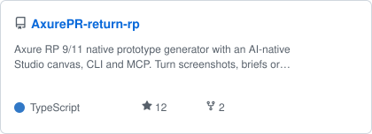
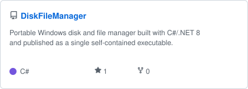
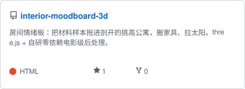
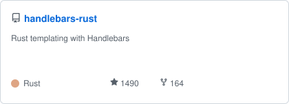
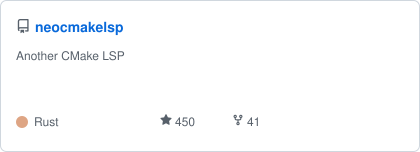
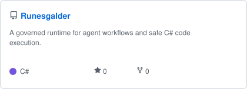
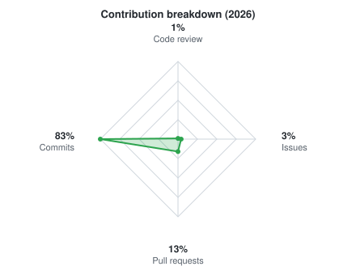

# Karl Moriaty

**Cybersecurity student · C# / Rust developer · Open-source maintainer**

[GitHub](https://github.com/karlmoriaty) · [X](https://x.com/karlmoriaty) · [npm](https://www.npmjs.com/~karlmoriaty) · [Email](mailto:karlmoriaty@gmail.com)

I'm a third-year cybersecurity student and software developer. C# is my favorite language: I build desktop tools with it, use Rust for low-level work, and work across the stack with Go, TypeScript, Node.js, and Vue. I help maintain [handlebars-rust](https://github.com/sunng87/handlebars-rust) with write access, and I'm currently building [Azzer](https://github.com/karlmoriaty/azzer) and [return_rp](https://github.com/karlmoriaty/AxurePR-return-rp).

I'm a big fan of Minecraft and League of Legends, and I also enjoy fighting games such as Naruto and Bleach vs. Naruto.

Feel free to look around! I hope you enjoy my projects, and don't forget to leave a star.

## Repositories

<!-- repositories:start -->

<a href="https://github.com/karlmoriaty/AxurePR-return-rp"><picture>
<source media="(prefers-color-scheme: dark)" srcset="https://raw.githubusercontent.com/karlmoriaty/karlmoriaty/main/assets/repos/dark/axurepr-return-rp.svg">

</picture></a>
<a href="https://github.com/karlmoriaty/DiskFileManager"><picture>
<source media="(prefers-color-scheme: dark)" srcset="https://raw.githubusercontent.com/karlmoriaty/karlmoriaty/main/assets/repos/dark/diskfilemanager.svg">

</picture></a>

<a href="https://github.com/karlmoriaty/interior-moodboard-3d"><picture>
<source media="(prefers-color-scheme: dark)" srcset="https://raw.githubusercontent.com/karlmoriaty/karlmoriaty/main/assets/repos/dark/interior-moodboard-3d.svg">

</picture></a>
<a href="https://github.com/sunng87/handlebars-rust"><picture>
<source media="(prefers-color-scheme: dark)" srcset="https://raw.githubusercontent.com/karlmoriaty/karlmoriaty/main/assets/repos/dark/handlebars-rust.svg">

</picture></a>

<a href="https://github.com/neocmakelsp/neocmakelsp"><picture>
<source media="(prefers-color-scheme: dark)" srcset="https://raw.githubusercontent.com/karlmoriaty/karlmoriaty/main/assets/repos/dark/neocmakelsp.svg">

</picture></a>
<a href="https://github.com/Runesgalder/Runesgalder"><picture>
<source media="(prefers-color-scheme: dark)" srcset="https://raw.githubusercontent.com/karlmoriaty/karlmoriaty/main/assets/repos/dark/runesgalder.svg">

</picture></a>

<!-- repositories:end -->

## Open Source

**handlebars-rust** — maintainer with write access · [repository](https://github.com/sunng87/handlebars-rust)  
1.5k+ stars · 106M+ downloads · 841 dependent crates  
Reviewing pull requests and helping maintain the Rust Handlebars implementation.

**neocmakelsp** — contributor  
Fixed Windows `find_package` handling across multiple `CMAKE_PREFIX_PATH` entries ([PR #414](https://github.com/neocmakelsp/neocmakelsp/pull/414), merged).

Also contributed merged PRs to OpenTofu, Agones, Redux, MaterialDesignInXaml, Nuclei, vscode-beancount, and openDCIM.

## Connect

---

## 中文（简体）

你好！我是 Karl Moriaty（卡尔是我的名，莫里亚蒂是我的姓），目前是一名大三的在校大学生，即将升入大四。

作为一名网络安全初学者和软件开发者，我正在努力成为一名网络安全工程师，或者一名纯粹的程序员。

C# 是我最喜欢的编程语言，我也喜欢使用 Go 和 TypeScript，并且非常热衷于 Rust。我会用 C# 写一些小工具方便日常使用；涉及底层逻辑开发时，我喜欢用 Rust 做基础设施或重构。

目前我主要活跃在全栈技术栈中（以桌面开发为主）：后端使用 C#、Go、Rust、Node.js，前端使用 JavaScript/TypeScript、HTML、CSS、Vue。我还在用 Rust 开发一个 AI 翻唱工具 [Azzer](https://github.com/karlmoriaty/azzer)。

目前我是 [handlebars-rust](https://github.com/sunng87/handlebars-rust) 的 write 权限维护者，并在开发 [return_rp](https://github.com/karlmoriaty/AxurePR-return-rp)（Axure RP MCP 服务器）和 Azzer。

我非常喜欢玩 Minecraft 和英雄联盟，也喜欢一些格斗游戏（比如火影忍者、死神 VS 火影）。

欢迎随便逛逛！希望你能喜欢我写的程序，也别忘了点个 star。

### 社交账号

- GitHub: [karlmoriaty](https://github.com/karlmoriaty)
- X: [@karlmoriaty](https://x.com/karlmoriaty)
- npm: [karlmoriaty](https://www.npmjs.com/~karlmoriaty)
- 邮箱: [karlmoriaty@gmail.com](mailto:karlmoriaty@gmail.com)

---

## GitHub Stats

| GitHub Stats | Most Used Languages |
|:---:|:---:|
|  |  |

## Contribution Breakdown

  <picture>
    <source media="(prefers-color-scheme: dark)" srcset="https://raw.githubusercontent.com/karlmoriaty/karlmoriaty/main/assets/contrib-radar-dark.svg">
    
  </picture>

## Languages and Tools

### Languages

### Databases

### Tools and IDEs

